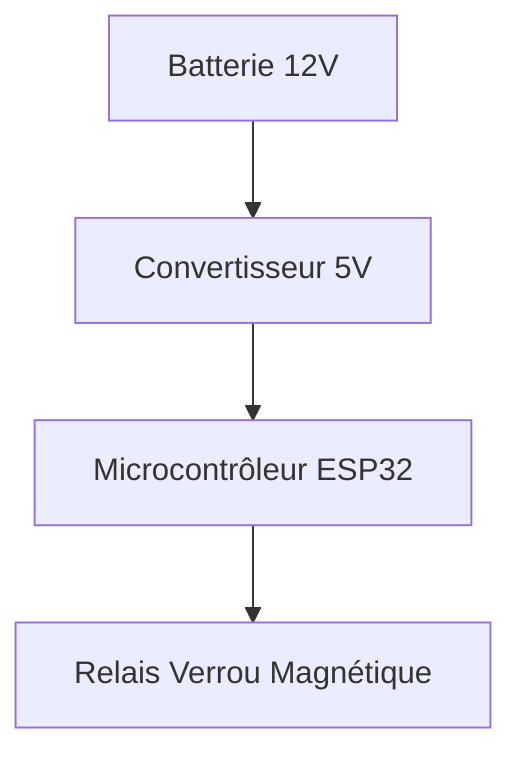

# ⚔️ Wiki Techs GN

> Base de connaissances collaborative dédiée aux solutions techniques, outils logiciels, montages électroniques, accessoires et décors pour les jeux de rôles grandeur nature (GN / LARP).

🌐 **Site en ligne** : [https://Pommovore.github.io/wiki-techs-gn/](https://Pommovore.github.io/wiki-techs-gn/)

---

## 🎯 Intention du Projet

L'organisation et l'animation de jeux de rôles grandeur nature font appel à une multitude de compétences techniques et artisanales : conception d'applications web de logistique, électronique embarquée (Arduino, ESP32, Raspberry Pi), effets sonores ou lumineux interactifs, mécanismes d'énigmes, accessoires scénographiques et décors immersifs.

Trop souvent, ces projets sont développés de façon isolée au sein d'une association, puis oubliés ou difficilement réutilisables par d'autres équipes faute de documentation accessible.

**Wiki Techs GN** a pour mission de :
* **Centraliser et pérenniser le savoir-faire technique** propre au monde du GN.
* **Mettre en avant les projets existants** (ex: plateformes de gestion comme **GNôle**, accessoires interactifs, systèmes son/lumière).
* **Partager des plans, schémas et codes sources** immédiatement réutilisables ou adaptables.
* **Faciliter l'entraide technique** entre organisateurs, créateurs, développeurs et bricoleurs.

---

## 🛠️ Solutions Techniques Adoptées

Pour assurer une maintenance aisée, une collaboration fluide et un hébergement sans frais, le projet s'appuie sur la stack suivante :

* **Générateur de documentation statique** : [MkDocs](https://www.mkdocs.org/) avec le thème [Material for MkDocs](https://squidfunk.github.io/mkdocs-material/).
    * Navigation fluide en Single Page Application (`navigation.instant`).
    * Moteur de recherche plein texte avec auto-complétion et surbrillance des résultats.
    * Thème clair / sombre commutable avec adaptation automatique.
    * Prise en charge des blocs de code avec coloration syntaxique et bouton de copie instantanée.
    * Support natif des alertes visuelles (*admonitions*) et blocs déroulants (*details*).
    * Rendu direct des schémas et logigrammes grâce à **Mermaid.js**.
* **Hébergement & Déploiement Continu** : **GitHub Pages** alimenté automatiquement par un workflow **GitHub Actions** (`.github/workflows/deploy.yml`) à chaque mise à jour de la branche `main`.
* **Gestion des dépendances** : Compatible Python 3.12+ avec `uv` ou `pip`.

---

## 📂 Structure du Répertoire

```text
.
├── .github/
│   └── workflows/
│       └── deploy.yml          # Pipeline CI/CD de déploiement GitHub Pages
├── docs/                       # Fichiers sources en Markdown
│   ├── index.md                # Page d'accueil du wiki
│   ├── gestion/                # Outils logiciels & organisation
│   │   └── gnole.md            # Fiche détaillée du projet GNôle
│   ├── electronique/           # (À venir) Montages, Arduino, capteurs
│   └── decors/                 # (À venir) Mécanismes, fabrication, accessoires
├── mkdocs.yml                  # Fichier de configuration MkDocs
└── README.md                   # Ce document
```

---

## 🚀 Processus pour Ajouter un Nouveau Projet

Ajouter une nouvelle fiche projet ou documenter une technique se fait simplement via Git et Markdown.

### Étape 1 : Cloner le dépôt et créer une branche

```bash
git clone git@github.com:Pommovore/wiki-techs-gn.git
cd wiki-techs-gn
git checkout -b ajout-mon-projet
```

### Étape 2 : Créer le fichier Markdown

Créez votre document dans la sous-catégorie appropriée du dossier `docs/` (ex: `docs/gestion/`, `docs/electronique/` ou `docs/decors/`) :

```bash
touch docs/electronique/bombe-factice.md
```

Structure type recommandée pour une fiche projet :

```markdown
# Nom du Projet

Description rapide en une ou deux phrases du but du projet.

## 🔗 Liens Rapides
* 🌐 Site web / Démo : https://...
* 💻 Code source : https://...
* 💬 Contact / Communauté : https://...

## 🎯 Présentation & Fonctionnalités
Présentation détaillée des fonctionnalités, des cas d'usage en jeu et des bénéfices pour les joueurs ou organisateurs.

## ⚙️ Matériel & Schémas Techniques
Liste des composants requis, consignes de montage et éventuels schémas Mermaid :



## 🛠️ Installation / Utilisation
Étapes pas à pas pour reproduire ou déployer la solution.
```

### Étape 3 : Déclarer la page dans la navigation

Ouvrez le fichier [`mkdocs.yml`](mkdocs.yml) et ajoutez votre nouvel article dans la section `nav` :

```yaml
nav:
  - Accueil: index.md
  - Gestion:
      - GNôle: gestion/gnole.md
  - Électronique:
      - Bombe factice désamorçable: electronique/bombe-factice.md
```

### Étape 4 : Tester le rendu en local

Lancez le serveur de développement MkDocs pour visualiser vos modifications en temps réel :

```bash
# Avec uv (recommandé) :
uv run --with mkdocs-material mkdocs serve

# Ou avec un environnement virtuel classique :
source .venv/bin/activate
pip install mkdocs-material
mkdocs serve
```

Ouvrez votre navigateur à l'adresse indiquée (généralement `http://127.0.0.1:8000`).

### Étape 5 : Valider et proposer la contribution

Une fois le rendu validé en local :

```bash
git add docs/ mkdocs.yml
git commit -m "docs: ajout de la fiche projet pour ..."
git push origin ajout-mon-projet
```

Ouvrez ensuite une **Pull Request** sur GitHub vers la branche `main`. Dès qu'elle sera fusionnée, GitHub Actions compilera le site et le déploiera automatiquement sur GitHub Pages.
